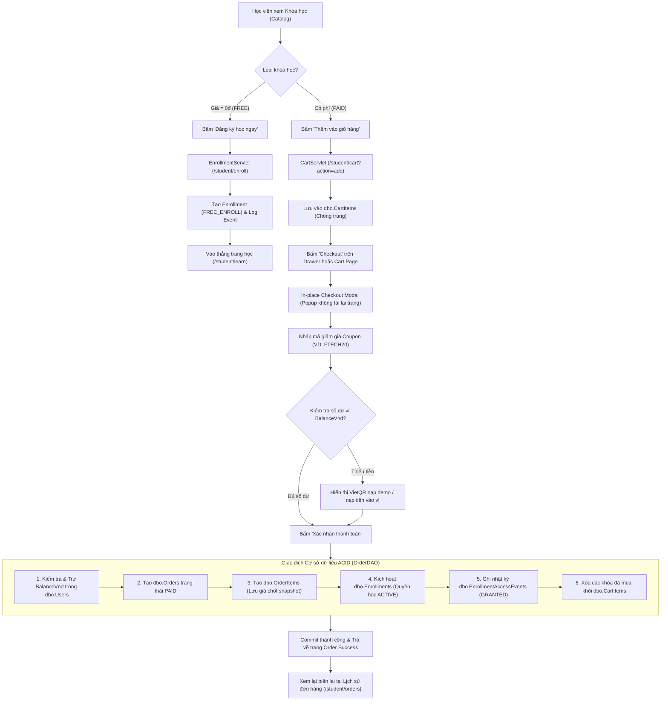

# BÁO CÁO TOÀN DIỆN PHẦN VIỆC & KỊCH BẢN THUYẾT TRÌNH BẢO VỆ PROJECT MÔN HỌC PRJ301 (ĐẠI HỌC FPT CẦN THƠ)
**Dự án:** Ftech LMS — Nền tảng học trực tuyến  
**Thành viên thực hiện:** **Nguyễn Phát Tài**  
**Công nghệ:** Java Servlet (Jakarta EE 10 / Servlet 6.0), JSP, JSTL, JDBC, SQL Server, Apache POI  
**Ngày cập nhật:** 09/11/2026  

---

## MỤC LỤC
1. [Tổng quan Phân công Công việc của Tài (Đối soát Bảng phân công)](#1-tổng-quan-phân-công-công-việc-của-tài)
2. [Sơ đồ Kiến trúc & Luồng Nghiệp vụ Trọng tâm](#2-sơ-đồ-kiến-trúc--luồng-nghiệp-vụ-trọng-tâm)
3. [Chi tiết Kỹ thuật Từng Module Do Tài Đảm Nhiệm](#3-chi-tiết-kỹ-thuật-từng-module-do-tài-đảm-nhiệm)
   - [Module 1: Thiết kế Database & Quản lý Transaction JDBC](#module-1-thiết-kế-database--quản-lý-transaction-jdbc)
   - [Module 2: Quản lý Giỏ hàng (Cart Module)](#module-2-quản-lý-giỏ-hàng-cart-module)
   - [Module 3: Đăng ký Khóa học Miễn phí 0đ (Enrollment Module)](#module-3-đăng-ký-khóa-học-miễn-phí-0đ-enrollment-module)
   - [Module 4: Đặt hàng & Thanh toán Trừ Ví (Checkout & Payment)](#module-4-đặt-hàng--thanh-toán-trừ-ví-checkout--payment)
   - [Module 5: Lịch sử Đơn hàng & Biên lai (Order History Module)](#module-5-lịch-sử-đơn-hàng--biên-lai-order-history-module)
   - [Module 6: Quản trị Đơn hàng & Đối soát Thanh toán (Admin Orders)](#module-6-quản-trị-đơn-hàng--đối-soát-thanh-toán-admin-orders)
   - [Module 7: Quản lý Danh mục & Nhập/Xuất Excel (Category & Excel)](#module-7-quản-lý-danh-mục--nhậpxuất-excel-category--excel)
   - [Module 8: Phân quyền Đa vai trò Người dùng (User Roles)](#module-8-phân-quyền-đa-vai-trò-người-dùng-user-roles)
   - [Module 9: Kiểm duyệt Nội dung Vi phạm (Moderation Module)](#module-9-kiểm-duyệt-nội-dung-vi-phạm-moderation-module)
   - [Module 10: Xử lý Cookie Ghi nhớ 60 phút Không Tương tác](#module-10-xử-lý-cookie-ghi-nhớ-60-phút-không-tương-tác)
4. [Kịch bản Demo Từng Bước Khi Đứng Trước Hội Đồng](#4-kịch-bản-demo-từng-bước-khi-đứng-trước-hội-đồng)
5. [Cẩm nang Phản biện: Các Câu hỏi Giảng viên Hay Hỏi & Cách Trả lời Ăn Điểm](#5-cẩm-nang-phản-biện-các-câu-hỏi-giảng-viên-hay-hỏi--cách-trả-lời-ăn-điểm)

---

## 1. TỔNG QUAN PHÂN CÔNG CÔNG VIỆC CỦA TÀI

Dựa theo bảng phân công chính thức của nhóm (**`Phân công - Trang tính1.pdf`**), Tài chịu trách nhiệm toàn bộ các phân hệ liên quan đến: **Thiết kế Database hệ thống, Trang chủ Catalog, Giỏ hàng, Đăng ký học, Thanh toán & Đơn hàng, Quản trị đơn hàng Admin, Quản lý danh mục, Phân quyền người dùng, Kiểm duyệt nội dung** và **Điểm thưởng Excel / Cookie**.

### Bảng đối soát chi tiết từng đầu việc:
| STT | Phân hệ / Servlet | URL Endpoint | Sprint | Trạng thái |
| :---: | :--- | :--- | :---: | :---: |
| 1 | **Database & JDBC** | `FtechDemoDB` / `DBContext.java` | Sprint 1 | **Hoàn thành 100%** |
| 2 | **Trang chủ Catalog** | `/` (`PublicCatalogServlet`) | Sprint 1 | **Hoàn thành 100%** |
| 3 | **Giỏ hàng (Cart)** | `/student/cart` (`CartServlet`) | Sprint 1 | **Hoàn thành 100%** |
| 4 | **Sửa/Xóa Danh mục** | `/admin/category` (`CategoryServlet`) | Sprint 1 | **Hoàn thành 100%** |
| 5 | **Phân quyền User** | `/admin/user?action=roles` (`UserManagementServlet`) | Sprint 1-2 | **Hoàn thành 100%** |
| 6 | **Đăng ký khóa 0đ** | `/student/enroll` (`EnrollmentServlet`) | Sprint 2 | **Hoàn thành 100%** |
| 7 | **Checkout & Mua khóa** | `/student/checkout` (`CheckoutServlet`) | Sprint 2 | **Hoàn thành 100%** |
| 8 | **Lịch sử đơn hàng** | `/student/orders` (`OrderServlet`) | Sprint 3 | **Hoàn thành 100%** |
| 9 | **Kiểm duyệt nội dung** | `/admin/moderation` (`ModerationServlet`) | Sprint 3 | **Hoàn thành 100%** |
| 10 | **Đối soát đơn Admin** | `/admin/orders` (`AdminOrderServlet`) | Sprint 4 | **Hoàn thành 100%** |
| 11 | **Bonus: Thao tác Excel**| `/admin/orders/export`, `/admin/category?action=import` | Bonus | **Hoàn thành 100%** |
| 12 | **Tiêu chí Cookie 60p** | `rememberedUser` Cookie / `RememberMeFilter.java` | Core 5% | **Hoàn thành 100%** |

---

## 2. SƠ ĐỒ KIẾN TRÚC & LUỒNG NGHIỆP VỤ TRỌNG TÂM

### Luồng 1: Mua khóa học có phí & Thanh toán nguyên tử (Atomic Checkout Flow)


---

## 3. CHI TIẾT KỸ THUẬT TỪNG MODULE DO TÀI ĐẢM NHIỆM

### Module 1: Thiết kế Database & Quản lý Transaction JDBC
- **File:** [`config/DBContext.java`](file:///D:/prj_project_final/GroupASM/src/main/java/config/DBContext.java), [`GroupASM/database/FtechDemo_SQLServer.sql`](file:///D:/prj_project_final/GroupASM/database/FtechDemo_SQLServer.sql).
- **Cơ chế kỹ thuật:**
  - Thiết kế chuẩn 29 bảng theo kiến trúc phân hệ: Tài khoản (`Users`, `Roles`, `UserRoles`), Khóa học (`Courses`, `Categories`, `Chapters`, `Lessons`), Mua sắm (`Carts`, `CartItems`, `Orders`, `OrderItems`), Học tập (`Enrollments`, `LessonProgress`), Đánh giá & Giám sát (`CourseReviews`, `DiscussionPosts`, `AuditLogs`).
  - Hàm `beginTransaction()` tắt `setAutoCommit(false)`, trả về `Connection` duy nhất để truyền qua nhiều DAO trong cùng 1 nghiệp vụ.
  - Hàm `rollbackQuietly(Connection conn)` đảm bảo khi xảy ra lỗi `SQLException`, toàn bộ thay đổi sẽ được hoàn tác sạch sẽ, không bao giờ xảy ra lỗi trừ tiền mà không nhận được khóa học.

---

### Module 2: Quản lý Giỏ hàng (Cart Module)
- **Files:** [`controler/CartServlet.java`](file:///D:/prj_project_final/GroupASM/src/main/java/controler/CartServlet.java), [`dao/CartDAO.java`](file:///D:/prj_project_final/GroupASM/src/main/java/dao/CartDAO.java), [`WEB-INF/view/student/cart.jsp`](file:///D:/prj_project_final/GroupASM/src/main/webapp/WEB-INF/view/student/cart.jsp), [`WEB-INF/view/student/cart-drawer.jsp`](file:///D:/prj_project_final/GroupASM/src/main/webapp/WEB-INF/view/student/cart-drawer.jsp).
- **Quy tắc nghiệp vụ (Business Rules):**
  1. **Chặn mua trùng:** Khi gọi `action=add`, `CartServlet` kiểm tra `enrollmentDAO.isEnrolled(studentId, courseId)`. Nếu học viên đã sở hữu khóa học thì từ chối thêm vào giỏ.
  2. **Một khóa học 1 dòng:** Bảng `dbo.CartItems` có ràng buộc `UNIQUE (CartId, CourseId)`. Không cho phép tăng số lượng khóa học (khóa học trực tuyến số lượng luôn là 1).
  3. **Cart Drawer trượt:** Hỗ trợ xem giỏ hàng trượt mượt mà từ bên phải và trang giỏ hàng toàn màn hình.

---

### Module 3: Đăng ký Khóa học Miễn phí 0đ (Enrollment Module)
- **Files:** [`controler/EnrollmentServlet.java`](file:///D:/prj_project_final/GroupASM/src/main/java/controler/EnrollmentServlet.java), [`dao/EnrollmentDAO.java`](file:///D:/prj_project_final/GroupASM/src/main/java/dao/EnrollmentDAO.java).
- **Quy tắc nghiệp vụ:**
  - Chỉ áp dụng cho khóa học có `PricingType = 'FREE'` hoặc giá bằng `0đ` và trạng thái `PUBLISHED`.
  - Khóa học có phí (`PAID`) gửi request vào đây sẽ bị chặn và buộc chuyển hướng sang giỏ hàng/thanh toán.
  - Ghi nhận `SourceType = 'FREE_ENROLL'` và ghi nhật ký kiểm toán vào `dbo.EnrollmentAccessEvents`.

---

### Module 4: Đặt hàng & Thanh toán Trừ Ví (Checkout & Payment)
- **Files:** [`controler/CheckoutServlet.java`](file:///D:/prj_project_final/GroupASM/src/main/java/controler/CheckoutServlet.java), [`dao/OrderDAO.java`](file:///D:/prj_project_final/GroupASM/src/main/java/dao/OrderDAO.java), [`WEB-INF/view/student/checkout.jsp`](file:///D:/prj_project_final/GroupASM/src/main/webapp/WEB-INF/view/student/checkout.jsp).
- **Quy tắc nghiệp vụ & Transaction:**
  - Đọc lại giá từ server (không bao giờ tin giá client gửi lên).
  - Áp dụng mã giảm giá Coupon (`dbo.Coupons`), tính toán `SubtotalVnd`, `DiscountVnd`, `TotalVnd`.
  - **Khối Transaction nguyên tử (ACID):**
    ```java
    conn = DBContext.beginTransaction();
    // 1. Trừ tiền ví: UPDATE dbo.Users SET BalanceVnd = BalanceVnd - ? WHERE UserId = ? AND BalanceVnd >= ?
    // 2. Chèn Order & OrderItems trạng thái PAID
    // 3. Cấp Enrollment cho từng khóa học trong đơn
    // 4. Ghi log EnrollmentAccessEvents (AccessAction='GRANTED', Reason='ORDER_PURCHASE')
    // 5. Xóa các khóa học vừa mua khỏi dbo.CartItems
    conn.commit();
    ```
  - **Idempotency Key:** Sử dụng khóa chống trùng lặp request khi người dùng bấm đúp chuột vào nút thanh toán.

---

### Module 5: Lịch sử Đơn hàng & Biên lai (Order History Module)
- **Files:** [`controler/OrderServlet.java`](file:///D:/prj_project_final/GroupASM/src/main/java/controler/OrderServlet.java), [`WEB-INF/view/student/orders.jsp`](file:///D:/prj_project_final/GroupASM/src/main/webapp/WEB-INF/view/student/orders.jsp), [`WEB-INF/view/student/order-detail.jsp`](file:///D:/prj_project_final/GroupASM/src/main/webapp/WEB-INF/view/student/order-detail.jsp).
- **Quy tắc nghiệp vụ:**
  - Học viên chỉ xem được đơn hàng của chính mình (`WHERE StudentId = ?`).
  - Biên lai hiển thị chi tiết snapshot giá tại thời điểm mua (không bị ảnh hưởng khi giảng viên tăng/giảm giá khóa học sau này).

---

### Module 6: Quản trị Đơn hàng & Đối soát Thanh toán (Admin Orders)
- **Files:** [`controler/AdminOrderServlet.java`](file:///D:/prj_project_final/GroupASM/src/main/java/controler/AdminOrderServlet.java), [`WEB-INF/view/admin/orders.jsp`](file:///D:/prj_project_final/GroupASM/src/main/webapp/WEB-INF/view/admin/orders.jsp).
- **Chức năng:**
  - Bộ lọc trạng thái đơn: `ALL`, `PAID`, `PENDING_PAYMENT`, `PAYMENT_REVIEW`.
  - **Tính năng Đối soát (`reconcile`):** Khi có giao dịch chuyển khoản muộn hoặc lỗi từ cổng thanh toán, Admin bấm "Đối soát" để chuyển trạng thái sang `PAID`, hệ thống sẽ kích hoạt ngay quyền học cho học viên mà không cần mua lại.
  - **Bonus Excel Export:** Nút **"Xuất Báo Cáo Excel (.xlsx)"** gọi `ExcelUtil.exportOrders()`, xuất file báo cáo doanh thu chuẩn form kế toán.

---

### Module 7: Quản lý Danh mục & Nhập/Xuất Excel (Category & Excel)
- **Files:** [`controler/CategoryServlet.java`](file:///D:/prj_project_final/GroupASM/src/main/java/controler/CategoryServlet.java), [`dao/CategoryDAO.java`](file:///D:/prj_project_final/GroupASM/src/main/java/dao/CategoryDAO.java), [`util/ExcelUtil.java`](file:///D:/prj_project_final/GroupASM/src/main/java/util/ExcelUtil.java), [`WEB-INF/view/admin/categories.jsp`](file:///D:/prj_project_final/GroupASM/src/main/webapp/WEB-INF/view/admin/categories.jsp).
- **Chức năng & Nghiệp vụ:**
  - Thêm, sửa danh mục, tự sinh Slug URL chuẩn SEO.
  - **Kiểm tra chống xóa khóa học liên kết:** Nếu danh mục đang có khóa học (`hasCourses(id)`), hệ thống chặn xóa và cảnh báo người dùng.
  - **Bonus Excel Import/Template:**
    - Tải file mẫu: `/admin/category?action=template` sinh file `Mau_Nhap_Danh_Muc.xlsx`.
    - Upload nhập hàng loạt: `/admin/category?action=import` đọc file `.xlsx` bằng Apache POI và tự động lưu vào database.

---

### Module 8: Phân quyền Đa vai trò Người dùng (User Roles)
- **Files:** [`controler/UserManagementServlet.java`](file:///D:/prj_project_final/GroupASM/src/main/java/controler/UserManagementServlet.java), [`dao/UserDAO.java`](file:///D:/prj_project_final/GroupASM/src/main/java/dao/UserDAO.java), [`WEB-INF/view/admin/users.jsp`](file:///D:/prj_project_final/GroupASM/src/main/webapp/WEB-INF/view/admin/users.jsp).
- **Chức năng:**
  - Khóa / Mở khóa tài khoản người dùng (`ACTIVE` / `LOCKED`).
  - Cập nhật vai trò đa năng (`UserRoles`): Cho phép 1 tài khoản vừa là `INSTRUCTOR` vừa là `STUDENT`.
  - Bắt buộc tối thiểu 1 vai trò, tự động cập nhật lại quyền Session nếu Admin đang tự cấp quyền cho chính mình.

---

### Module 9: Kiểm duyệt Nội dung Vi phạm (Moderation Module)
- **Files:** [`controler/ModerationServlet.java`](file:///D:/prj_project_final/GroupASM/src/main/java/controler/ModerationServlet.java), [`dao/ModerationDAO.java`](file:///D:/prj_project_final/GroupASM/src/main/java/dao/ModerationDAO.java), [`WEB-INF/view/admin/moderation.jsp`](file:///D:/prj_project_final/GroupASM/src/main/webapp/WEB-INF/view/admin/moderation.jsp).
- **Nghiệp vụ Xóa mềm (Soft Delete):**
  - Chuyển cờ `IsHidden = 1` thay vì xóa dòng dữ liệu khỏi database, bảo toàn tính toàn vẹn dữ liệu cho thống kê và luồng phản hồi cha-con trong thảo luận.
  - Hỗ trợ xem danh sách bài thảo luận vi phạm và đánh giá sao độc hại để Ẩn hoặc Khôi phục.

---

### Module 10: Xử lý Cookie Ghi nhớ 60 phút Không Tương tác
- **Files:** [`filter/RememberMeFilter.java`](file:///D:/prj_project_final/GroupASM/src/main/java/filter/RememberMeFilter.java), [`controler/LoginServlet.java`](file:///D:/prj_project_final/GroupASM/src/main/java/controler/LoginServlet.java), [`controler/LogoutServlet.java`](file:///D:/prj_project_final/GroupASM/src/main/java/controler/LogoutServlet.java).
- **Cơ chế:**
  - Khi đăng nhập tích chọn "Remember me", hệ thống cấp Cookie `rememberedUser` thời hạn 60 phút (`3600s`).
  - Filter áp dụng cơ chế **Sliding Expiration**: Mỗi khi người dùng có click hay request, thời hạn Cookie và Session tự động gia hạn thêm 60 phút.
  - Nếu người dùng bỏ máy không tương tác trong 60 phút, Cookie và Session sẽ tự động hết hạn, đảm bảo an toàn tuyệt đối.

---

## 4. KỊCH BẢN DEMO TỪNG BƯỚC KHI ĐỨNG TRƯỚC HỘI ĐỒNG

Khi đến lượt Tài thuyết trình, hãy mở trình duyệt và thực hiện theo kịch bản chuẩn sau:

### Bước 1: Giới thiệu Kiến trúc Database & Quản lý Transaction
* **Nói:** *"Em chào thầy cô, em là Nguyễn Phát Tài. Trong đồ án Ftech LMS, em phụ trách thiết kế Database 29 bảng, phân hệ Giỏ hàng, Đặt hàng thanh toán, Quản lý đơn hàng Admin, Quản lý danh mục, Phân quyền và các tính năng nâng cao như Excel và Cookie."*
* **Thao tác:** Mở file [`DBContext.java`](file:///D:/prj_project_final/GroupASM/src/main/java/config/DBContext.java), chỉ vào hàm `beginTransaction()` và giải thích cơ chế quản lý giao dịch an toàn khi học viên thanh toán.

### Bước 2: Demo Giỏ hàng & Thanh toán In-place (Student Flow)
* **Thao tác:**
  1. Đăng nhập bằng tài khoản học viên: `student@learnora.test` / `student123`.
  2. Bấm vào một khóa học có phí (PAID) -> Bấm **"Thêm vào giỏ hàng"**.
  3. Mở **Cart Drawer** góc phải -> Bấm **Checkout**.
  4. Hiển thị Popup Modal -> Áp mã giảm giá `FTECH20` (giảm 20%).
  5. Giải thích: *"Hệ thống kiểm tra số dư ví học viên (`BalanceVnd`). Vì số dư đủ nên hệ thống thực hiện trừ tiền trực tiếp trong 1 Transaction nguyên tử."*
  6. Bấm thanh toán thành công -> Kiểm tra trang **Khóa học của tôi** đã xuất hiện khóa học mới, và trong giỏ hàng khóa học đó đã tự động được xóa đi.
  7. Vào trang **Lịch sử đơn hàng** (`/student/orders`) để xem hóa đơn và biên lai snapshot.

### Bước 3: Demo Nghiệp vụ Chống gian lận & Ràng buộc
* **Thao tác:** Quay lại khóa học vừa mua -> Bấm thử lại nút mua -> Hệ thống báo đã sở hữu khóa học và chặn thêm vào giỏ.

### Bước 4: Demo Quản trị Admin & Điểm thưởng Excel (Admin Flow)
* **Thao tác:**
  1. Đăng xuất học viên -> Đăng nhập tài khoản Admin: `admin@learnora.test` / `admin123`.
  2. Vào mục **Đơn hàng** (`/admin/orders`) -> Bấm nút **"Xuất Báo Cáo Excel (.xlsx)"** -> Mở file Excel vừa tải xuống cho giảng viên xem định dạng bảng tính chuyên nghiệp của thư viện Apache POI.
  3. Chỉ vào tính năng **"Đối soát"** đơn hàng khi có đơn bị nghẽn thanh toán.
  4. Sang mục **Danh mục** (`/admin/category`) -> Bấm **"Tải mẫu Excel"** -> Mở modal **"Nhập từ Excel (.xlsx)"** chứng minh có đầy đủ cả Import lẫn Export.
  5. Sang mục **Người dùng** (`/admin/users`) -> Demo tính năng cấp nhiều vai trò cùng lúc và khóa tài khoản vi phạm.

---

## 5. CẨM NANG PHẢN BIỆN: CÁC CÂU HỎI GIẢNG VIÊN HAY HỎI & CÁCH TRẢ LỜI ĂN ĐIỂM

### ❓ Câu 1: Tại sao em phải dùng Transaction khi thanh toán đơn hàng?
> **Trả lời:**  
> *"Dạ thưa thầy/cô, việc mua khóa học gồm 5 bước thay đổi CSDL liên hoàn: (1) Trừ số dư ví học viên, (2) Tạo đơn hàng, (3) Tạo chi tiết đơn hàng, (4) Cấp quyền ghi danh Enrollments, (5) Xóa sản phẩm khỏi giỏ hàng. Nếu không dùng Transaction, giả sử bước trừ tiền thành công nhưng bước cấp quyền học bị lỗi mạng hoặc crash database, học viên sẽ bị mất tiền oan mà không được học. Vì vậy em tắt `autoCommit(false)`, thực hiện toàn bộ thao tác trên cùng 1 Connection, chỉ commit khi tất cả thành công và rollback sạch sẽ nếu có lỗi để bảo đảm tính toàn vẹn dữ liệu (ACID)."*

### ❓ Câu 2: Dự án của em phòng chống SQL Injection như thế nào?
> **Trả lời:**  
> *"Dạ thưa thầy/cô, 100% các thao tác truy vấn trong toàn bộ các lớp DAO của em đều sử dụng `PreparedStatement` kết hợp với dấu hỏi chấm `?` làm parameter binding. Em tuyệt đối không bao giờ nối chuỗi dữ liệu người dùng vào câu SQL, vì vậy database sẽ biên dịch trước câu lệnh và coi input của người dùng đơn thuần là tham số dữ liệu, ngăn chặn hoàn toàn nguy cơ SQL Injection."*

### ❓ Câu 3: Em xử lý Cookie và Session trong dự án như thế nào?
> **Trả lời:**  
> *"Dạ thưa thầy/cô, em sử dụng Cookie `rememberedUser` để lưu email người dùng khi họ tích chọn 'Remember me' lúc đăng nhập. Để đảm bảo an toàn, em đã viết một lớp `RememberMeFilter` áp dụng cơ chế Sliding Timeout 60 phút: Mỗi khi người dùng có thao tác trên trang, Cookie và Session sẽ được tự động gia hạn thêm 60 phút. Nếu người dùng không tương tác trong 60 phút, Cookie và Session sẽ tự động hết hạn. Khi bấm Đăng xuất, em set `MaxAge(0)` để xóa Cookie ngay lập tức."*

### ❓ Câu 4: Vì sao bảng Categories không cho xóa dây chuyền (Cascade Delete) các khóa học?
> **Trả lời:**  
> *"Dạ, nếu xóa danh mục mà tự động xóa hết các khóa học thuộc danh mục đó thì sẽ vô tình xóa luôn lịch sử học tập, tiến độ và đơn hàng đã thanh toán của học viên. Vì vậy em cài đặt kiểm tra `hasCourses(categoryId)` trước khi xóa; nếu còn khóa học thì hệ thống sẽ từ chối xóa và yêu cầu chuyển danh mục cho các khóa học đó trước."*

### ❓ Câu 5: Chức năng Excel em tự viết hay dùng thư viện gì? Có đọc được định dạng mới không?
> **Trả lời:**  
> *"Dạ thưa thầy/cô, em tích hợp thư viện Apache POI (`poi-ooxml` phiên bản 5.2.5). Thư viện này hỗ trợ chuẩn định dạng XML mở (`.xlsx`) của Microsoft Excel hiện đại. Trong class `ExcelUtil`, em định dạng tiêu đề màu sắc, auto-size độ rộng cột theo nội dung, định dạng tiền tệ `#,##0 ₫`, và hỗ trợ cả luồng Export báo cáo lẫn Import dữ liệu hàng loạt từ file Excel vào CSDL."*

---

> 🎯 **Lời khuyên cho Tài:** Bạn chỉ cần nắm chắc luồng chạy của **Giỏ hàng -> Thanh toán Transaction -> Admin đối soát & Excel** là đã nắm trọn phần "xương sống" quan trọng nhất của cả dự án! Chúc bạn có buổi bảo vệ thành công rực rỡ và đạt điểm 10 tuyệt đối!
